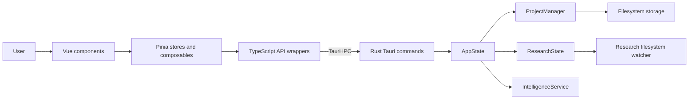

# System Architecture

BrutWrite is a desktop application built with Tauri 2. A Vue 3 and TypeScript frontend runs in the native WebView and calls a Rust backend through Tauri's IPC.

## High-level overview

## Frontend (`src/`)

The frontend is a Vite single-page application mounted by `src/main.ts`. It uses Pinia; the project does not use Vue Router.

Vite builds static frontend assets for the Tauri WebView; Rust remains the application backend. There is no production Node.js server or SSR layer. Vue is retained for component lifecycles and reactive UI state, with Tiptap's Vue integration for the editor.

Tailwind CSS 4 runs through `@tailwindcss/vite` in `vite.config.ts`. Theme tokens are defined with `@theme` in `src/style.css`. Components use plain `<style scoped>` blocks; those needing Tailwind directives reference `src/style.css` with `@reference`. There is no separate `tailwind.config.js` or `postcss.config.js`.

- **`src/api/`**: TypeScript wrappers that call registered Rust commands with `invoke`.
- **`src/stores/`**: Pinia stores for project, research, settings, snapshots, dialogs, and UI state.
- **`src/composables/`**: Reusable editor, project, timeline, character, intelligence, and UI logic.
- **`src/components/`**: Vue UI grouped by areas such as editor, characters, research, timeline, settings, and snapshots.
- **`src/config/`**, **`src/types/`**, and **`src/utils/`**: application defaults and constants, shared types, and utility logic.
- **`src/style.css`**: application-wide styling.

## Rust backend (`src-tauri/src/`)

- **`lib.rs`**: constructs the Tauri application, registers plugins, manages `AppState`, and exposes commands through `invoke_handler`.
- **`commands/`**: IPC entry points for projects, chapters, characters, research, snapshots, and character-graph analysis.
- **`models/`**: serializable project, chapter, character, and research data structures.
- **`project/`**: manages loaded project metadata and project lifecycle.
- **`storage/`**: reads and writes project metadata, chapter content, research indexes, and snapshots.
- **`research/`** and **`integrations/research_watcher.rs`**: maintain research state and watch a project's research directory for filesystem changes.
- **`intelligence/`**: scans manuscript chapters and builds character-interaction graph data.

`AppState` holds the project manager, research state, and intelligence service. Project metadata is loaded into the backend while a project is open and persisted to the project's `project.json` file.

## Chapter save flow

1. A Vue editor component updates its editor session and Pinia-backed UI state.
2. The editor session passes the editor's HTML string to the TypeScript chapter API wrapper.
3. The wrapper invokes `save_chapter` over Tauri IPC.
4. The Rust command creates a chapter snapshot, writes the chapter file under `manuscript/`, updates the chapter word count, and saves project metadata.
5. The command returns updated metadata, which the frontend uses to refresh project state.

## Browser limitation

`pnpm dev` starts the Vite frontend without a Tauri host. The application calls Tauri commands and uses native dialog and filesystem plugins directly; a browser preview therefore cannot create, load, or manage projects. Use `pnpm tauri dev` to run the supported desktop application.
