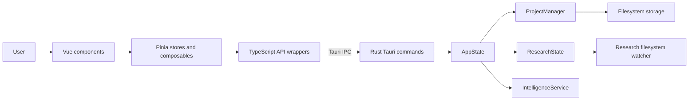

# System Architecture

BrutWrite is a desktop application built with Tauri 2. A Vue 3 and TypeScript frontend runs in the native WebView and calls a Rust backend through Tauri's IPC.

## High-level overview

## Frontend (`src/`)

The frontend is a Vite single-page application mounted by `src/main.ts`. It uses Pinia; the project does not use Vue Router.

Vite builds static frontend assets for the Tauri WebView; Rust remains the application backend. There is no production Node.js server or SSR layer. Vue is retained for component lifecycles and reactive UI state, with Tiptap's Vue integration for the editor.

Tailwind CSS 4 runs through `@tailwindcss/vite` in `vite.config.ts`. Theme tokens are defined with `@theme` in `src/style.css`. Components use plain `<style scoped>` blocks; those needing Tailwind directives reference `src/style.css` with `@reference`. There is no separate `tailwind.config.js` or `postcss.config.js`.

- **`src/api/`**: TypeScript wrappers that call registered Rust commands with `invoke`.
- **`src/stores/`**: Pinia stores for project, research, settings, snapshots, dialogs, and UI state.
- **`src/composables/`**: Reusable editor, project, timeline, character, intelligence, and UI logic.
- **`src/components/`**: Vue UI grouped by areas such as editor, characters, research, timeline, settings, and snapshots.
- **`src/config/`**, **`src/types/`**, and **`src/utils/`**: application defaults and constants, shared types, and utility logic.
- **`src/style.css`**: application-wide styling.

## Rust backend (`src-tauri/src/`)

- **`lib.rs`**: constructs the Tauri application, registers plugins, manages `AppState`, and exposes commands through `invoke_handler`.
- **`commands/`**: IPC entry points for projects, chapters, characters, research, snapshots, and character-graph analysis.
- **`models/`**: serializable project, chapter, character, and research data structures.
- **`project/`**: manages loaded project metadata and project lifecycle.
- **`storage/`**: reads and writes project metadata, chapter content, research indexes, and snapshots.
- **`research/`** and **`integrations/research_watcher.rs`**: maintain research state and watch a project's research directory for filesystem changes.
- **`intelligence/`**: scans manuscript chapters and builds character-interaction graph data.

`AppState` holds the project manager, research state, and intelligence service. Project metadata is loaded into the backend while a project is open and persisted to the project's `project.json` file.

## Chapter save flow

1. A Vue editor component updates its editor session and Pinia-backed UI state.
2. The editor session passes the editor's HTML string to the TypeScript chapter API wrapper.
3. The wrapper invokes `save_chapter` over Tauri IPC.
4. The Rust command creates a chapter snapshot, writes the chapter file under `manuscript/`, updates the chapter word count, and saves project metadata.
5. The frontend refreshes the saved chapter's word count without replacing the live manuscript tree.

Editor sessions capture project/chapter identities and drain edits made during an in-flight save before switching chapters, restoring snapshots, deleting nodes, changing projects, or closing the native window. Stale loads/restores cannot replace the current chapter. Save failures preserve the dirty session and block the transition.

Manifest and metadata synchronization is queued per project. Explicit flushes serialize queued work and retain failed updates for retry; optional timeline clears become JSON `null`. Project indexes contain Vue-reactive nodes, so cached title, word-count, and timeline views update after granular mutations.

Root-to-child drag operations resolve the destination by chapter ID, not its former array index. Nested updates preserve the array shared with Sortable until its synchronous add/remove callbacks finish, so removing a root retains the destination's updated children and the moved subtree. The backend rejects manifests that add or omit chapter IDs rather than silently deleting chapter data.

## Writing goals

The goal dashboard reads daily progress from writing history and project progress from the current manuscript's word counts. Entering goal-edit mode copies the current daily and project targets, including preferences loaded after the dashboard mounts. Daily goals persist in application settings; project targets persist in the project's settings.

## Editor and character sheets

Focus mode styles target the editor's root class and its active paragraph. Character traits retain their raw multiline input while editing; normalization at the model boundary must not remove a newly typed line break.

## Timeline and calendars

Timeline drops use capture-phase handling before vis-timeline consumes the event. Rendered items expose their chapter IDs so narrative connectors can resolve scene geometry. Flashback styling uses narrative chronology, not whether overlapping scene rectangles put the target to the left of the source's right edge.

Calendar changes redraw the current axis immediately. Custom calendars require at least one named month with positive, safe-integer day counts and a safe-integer epoch and total year length. Invalid drafts cannot replace the active calendar. Negative dates use floor division and positive remainders, keeping formatted years consistent with `getYear`.

PNG and PDF exports capture the timeline wrapper, including its grid and narrative overlay. The capture uses the active theme's background and resolves SVG color variables before serialization. Timeline controls wrap when the research pane is open instead of pushing it outside the window.

## Research previews

PDF.js workers, character maps, and standard fonts are bundled by Vite; preview rendering does not require a CDN or broader content security permissions. PDF and image viewers read local files through the filesystem plugin. Preview selection guards prevent obsolete requests from replacing the current document.

## Browser limitation

`pnpm dev` starts the Vite frontend without a Tauri host. The application calls Tauri commands and uses native dialog and filesystem plugins directly; a browser preview therefore cannot create, load, or manage projects. Use `pnpm tauri dev` (the package-script CLI) or `cargo tauri dev` (the installed Cargo subcommand) to run the supported desktop application. Both use the Tauri configuration's frontend development command and URL.

The desktop development URL and Vite's default listener use `127.0.0.1` explicitly, avoiding differences between Node's and WebKit's IPv4/IPv6 resolution of `localhost`. `TAURI_DEV_HOST` still overrides the Vite listener when supplied.
